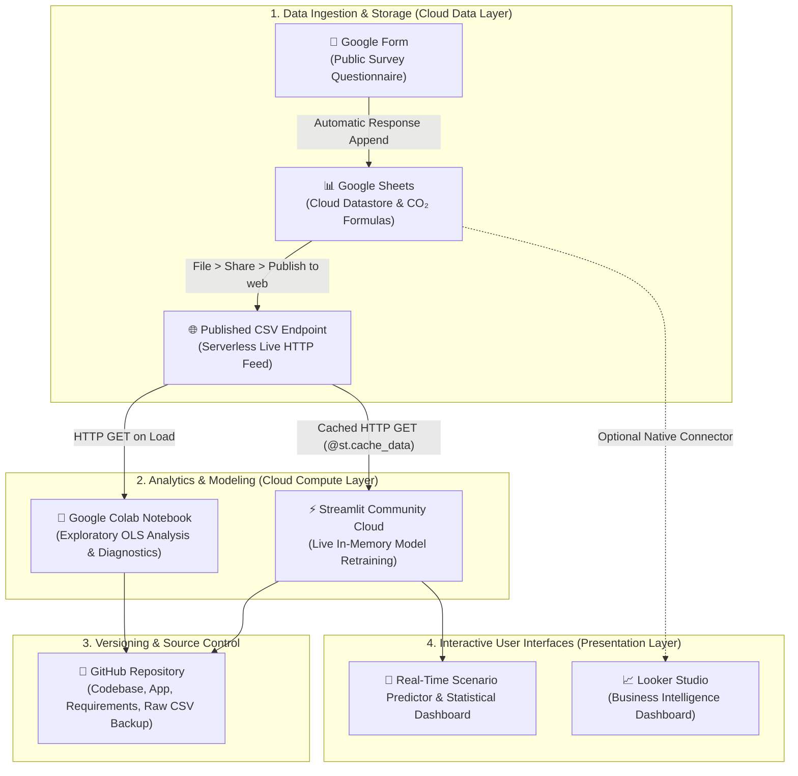

# 🌱 Weekly Carbon Footprint Linear Regression (Cloud Computing Mini-Project)

A lightweight, 100% free-tier cloud computing and data science project that predicts weekly carbon footprint from locality type and primary mode of transport. Designed specifically for academic coursework, this project prioritizes clean code, statistical explainability, and serverless cloud data pipelines.

---

## 🏛️ One-Page Cloud Architecture Summary



### Component Responsibility Breakdown
| Cloud Tool | Role in Stack | Cost | Rationale / Key Advantage |
| :--- | :--- | :--- | :--- |
| **Google Forms** | Data Collection | Free | Clean, mobile-friendly interface for crowdsourcing student responses. |
| **Google Sheets** | Cloud Datastore & ETL | Free | Automatically stores responses and applies emissions conversion formulas. |
| **Published CSV** | Serverless Data API | Free | Eliminates the need for API keys, OAuth tokens, or hosting a custom database. |
| **Google Colab** | Reproducible Analytics | Free | Cloud-hosted Jupyter environment for running regressions and generating plots. |
| **GitHub** | Code & Data Archive | Free | Public version control; acts as the CI/CD deployment trigger for Streamlit. |
| **Streamlit Community Cloud** | Live Web Application | Free | Re-reads live CSV on page load, retrains the regression in-memory, and provides an interactive predictor. |
| **Looker Studio** *(Optional)* | BI Dashboard | Free | Native zero-code connector directly to the Google Sheet for live aggregate charts. |

---

## 📂 Repository File Structure

```text
carbon-footprint-cloud-project/
├── app.py                            # Streamlit web application with interactive predictor
├── requirements.txt                  # Python dependencies for deployment
├── carbon_footprint_regression.ipynb # Colab/Jupyter notebook with step-by-step markdown
├── generate_notebook.py              # Generator script for recreating the notebook
├── raw_carbon_footprint_data.csv     # Archived snapshot of the dataset
└── README.md                         # Architecture summary, statistical report, and guide
```

---

## 🧹 Data Cleaning Pipeline

The published Google Sheet CSV feed (`~46 rows`) undergoes an automated cleaning pipeline:
1. **Whitespace Trimming**: All string headers and categorical values have leading/trailing whitespaces removed.
2. **Category Label Normalization**: Corrects spelling inconsistencies like `'Car(EV)'` $\rightarrow$ `'Car (EV)'`.
3. **Survey Placeholder Pruning**: Filters out accidental form tester selections (e.g., `'Option 10'`).
4. **Formula Error / Missing Value Handling**: Numeric fields are coerced via `pd.to_numeric(..., errors='coerce')`, safely dropping rows with `#N/A` or blank cells.
5. **Feature Synthesis**: Computes composite `Travel CO2 = Primary Travel CO2 + Secondary Travel CO2`.

---

## 🔬 Statistical Models & Regression Results

We specify two regression models to examine different facets of personal carbon emissions:

### Reference Baselines
To avoid the dummy variable trap, one category from each predictor is excluded:
- **Baseline Locality**: `Urban`
- **Baseline Primary Mode**: `Walk/Cycle`
- **Model Intercept ($\beta_0$)**: Expected emissions for an **Urban resident who Walks or Cycles**.

---

### Model 1: Per-Capita CO₂ ($n = 42$)
*Target*: Total weekly emissions divided by household size (`Per-Capita CO2`, in kg/week).

$$\text{Per-Capita CO}_2 = \beta_0 + \beta_{\text{Suburban}} X_{\text{Suburban}} + \sum_{j} \beta_j X_{\text{Mode}_j}$$

- **Intercept ($\beta_0$)**: `34.63 kg CO₂/week`
- **Model Fit**: $R^2 = 0.228$, $\text{Adjusted } R^2 = 0.069$, $F = 1.43$ ($p = 0.225$).
- **Academic Insight**: The low adjusted $R^2$ demonstrates that locality and commute mode alone explain very little of total per-capita emissions. Electricity usage (air conditioning, appliances) and household size dynamics dominate per-capita footprints, introducing substantial unexplained variance.

---

### Model 2: Travel CO₂ Only ($n = 44$)
*Target*: Primary Travel CO₂ + Secondary Travel CO₂ (`Travel CO2`, in kg/week).

$$\text{Travel CO}_2 = \beta_0 + \beta_{\text{Suburban}} X_{\text{Suburban}} + \sum_{j} \beta_j X_{\text{Mode}_j}$$

- **Intercept ($\beta_0$)**: `6.77 kg CO₂/week`
- **Model Fit**: $R^2 = 0.394$, $\text{Adjusted } R^2 = 0.276$, $F = 3.35$ ($p = 0.0075^{**}$).
- **Key Coefficients (Relative to Walk/Cycle)**:
  - **Car (Diesel)**: $+17.54 \text{ kg/week}$ ($t = 2.80, p = 0.008^{**}$)
  - **Car (Petrol)**: $+6.95 \text{ kg/week}$ ($t = 1.22, p = 0.230$)
  - **Train/Metro**: $+0.86 \text{ kg/week}$ ($t = 0.15, p = 0.881$)
  - **Bus**: $-3.55 \text{ kg/week}$ ($t = -0.42, p = 0.680$)
  - **Bike/Scooter**: $-3.89 \text{ kg/week}$ ($t = -0.67, p = 0.508$)
  - **Locality (Suburban)**: $-2.45 \text{ kg/week}$ ($t = -0.74, p = 0.464$)
- **Academic Insight**: Isolating transit emissions produces a statistically significant regression ($p < 0.01$). Driving a diesel passenger car adds approximately $17.5 \text{ kg}$ of weekly CO₂ relative to active commuting.

---

## ⚠️ Academic Limitations & Disclaimers

1. **Association, NOT Causation**:
   - Linear regression reveals statistical correlations in observational data. A positive coefficient does **not** prove that adopting a mode causes emissions to increase in isolation; respondents selecting cars may also commute longer distances or work different jobs.
2. **Small Sample Size ($n \approx 42-44$)**:
   - With approximately 40 responses, standard errors are broad and high-leverage outliers (e.g. one long trip) can distort individual coefficients.
3. **Omitted Variable Bias**:
   - Exact commute kilometers, vehicle fuel efficiency (km/L), carpooling passenger counts, and vehicle occupancy are unmeasured in the primary predictor set.
4. **Self-Reporting and Categorical Binning**:
   - Responses rely on coarse distance ranges (`"50-100 km"`, `"Under 10 km"`), introducing discretization errors.

---

## 🚀 Deployment Instructions

### Option A: Deploy on Render (Free Web Service)

Render provides a 100% free web service tier with automated continuous deployment directly from your GitHub repo.

#### Quick Deploy via Render Dashboard:
1. **Push your code to GitHub**:
   - Push your project files (`app.py`, `requirements.txt`, `render.yaml`, `.streamlit/config.toml`, `raw_carbon_footprint_data.csv`) to your GitHub repository.
2. **Log into Render**:
   - Visit [dashboard.render.com](https://dashboard.render.com) and sign in with GitHub.
3. **Create a New Web Service**:
   - Click **New +** > **Web Service**.
   - Connect your GitHub repository: `carbon-footprint-cloud-project`.
4. **Configure Settings**:
   - **Name**: `carbon-footprint-predictor`
   - **Language/Runtime**: `Python 3`
   - **Region**: Choose the closest region (e.g., Oregon, Frankfurt, Singapore)
   - **Branch**: `main`
   - **Build Command**:
     ```bash
     pip install -r requirements.txt
     ```
   - **Start Command**:
     ```bash
     streamlit run app.py --server.port $PORT --server.address 0.0.0.0
     ```
   - **Instance Type**: Select **Free** ($0/month).
5. **Click "Deploy Web Service"**:
   - Render will clone your repo, install dependencies, and launch your live application URL at `https://carbon-footprint-predictor-xxxx.onrender.com`.

*(Alternatively, Render will automatically detect the included [`render.yaml`](file:///C:/Users/ADMIN/.gemini/antigravity/scratch/carbon-footprint-cloud-project/render.yaml) Blueprint to prefill all settings!)*

---

### Option B: Deploy on Streamlit Community Cloud
1. Sign in to [share.streamlit.io](https://share.streamlit.io) using GitHub.
2. Click **New app**, select your repository, set branch to `main`, and main file to `app.py`.
3. Click **Deploy!**

---

## 📓 Running in Google Colab

1. Open [Google Colab](https://colab.research.google.com).
2. Click **Upload** and upload `carbon_footprint_regression.ipynb`.
3. Click **Runtime > Run all**.
4. The notebook dynamically fetches the live Google Sheet CSV feed, runs both OLS regressions, prints statistical summaries, displays coefficient bar charts, and runs the interactive scenario predictor.
